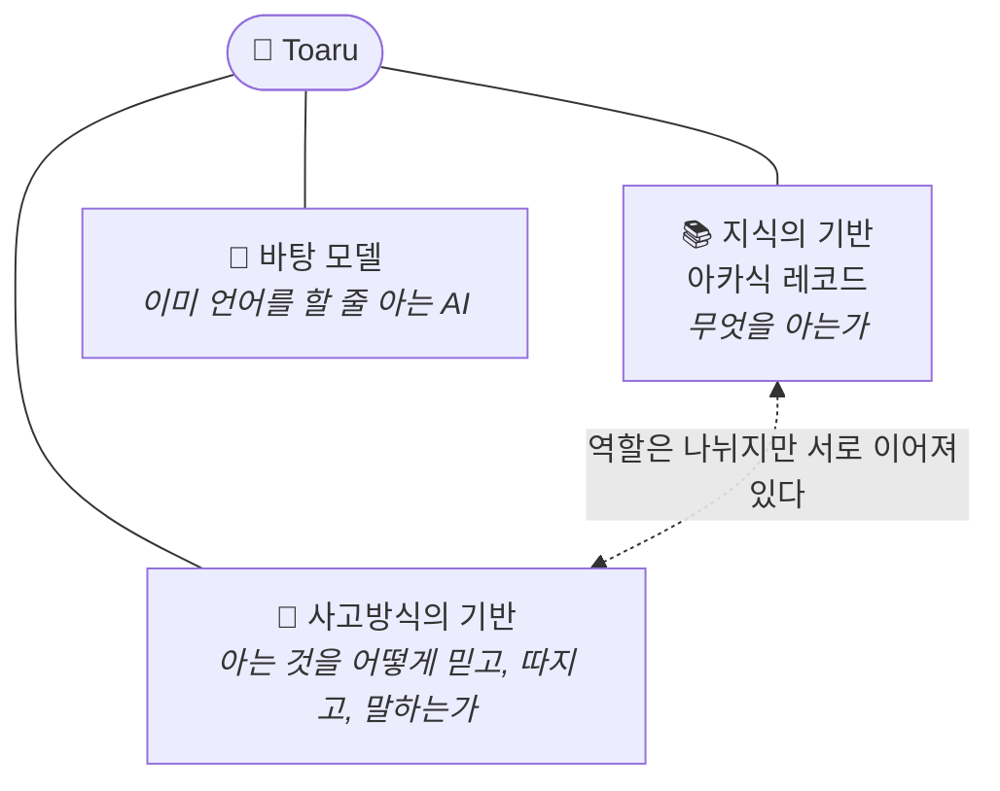
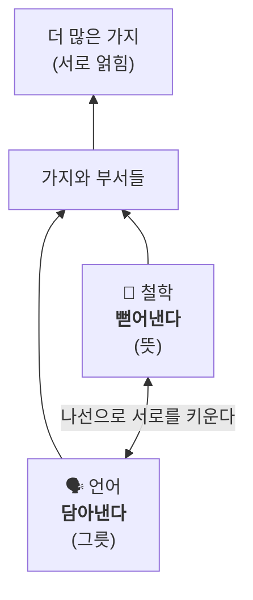
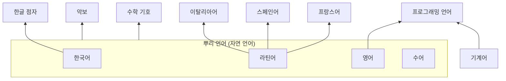
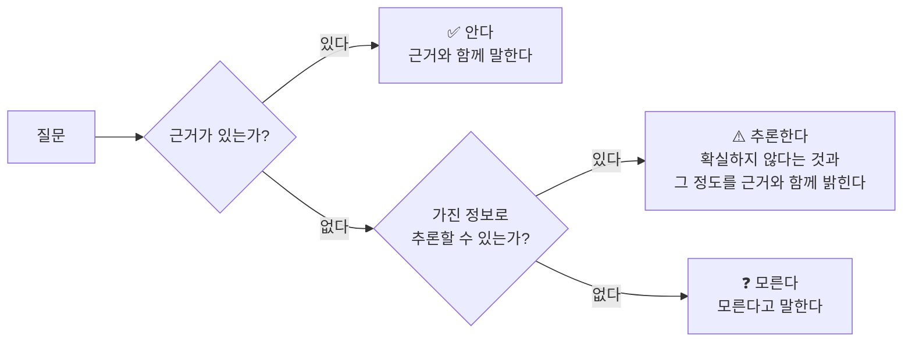
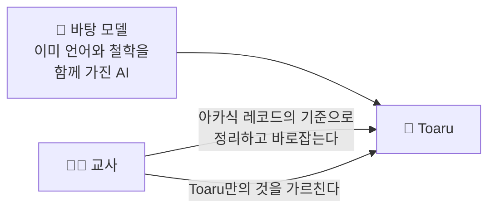

# 🏗️ Toaru 구조 설계

> [!NOTE]
> **미완성 문서예요. 계속 추가할 예정이에요.**
> 지금은 개념 설계 단계이고, 기술 설계는 아직 없어요.
> 마지막 갱신: 2026-11-11

Toaru가 **어떻게 생겼는지** 정리한 문서예요.
Toaru를 **어떻게 만들어 가는지**는 [제작 계획 문서](PLAN.md)를 보세요.

---

## 목차

1. [전체 구조: 두 개의 기반](#1-전체-구조-두-개의-기반)
2. [아카식 레코드: 지식의 기반](#2-아카식-레코드-지식의-기반)
3. [뿌리: 언어와 철학](#3-뿌리-언어와-철학)
4. [언어 뿌리](#4-언어-뿌리)
5. [철학 뿌리](#5-철학-뿌리)
6. [다른 부서들](#6-다른-부서들)
7. [사고방식의 기반](#7-사고방식의-기반)
8. [바탕 모델과의 관계](#8-바탕-모델과의-관계)

---

## 1. 전체 구조: 두 개의 기반



| 기반 | 다루는 질문 | 자세히 |
|---|---|---|
| 📚 **지식의 기반** (아카식 레코드) | 무엇을 아는가? | [2장](#2-아카식-레코드-지식의-기반) |
| 🧠 **사고방식의 기반** | 아는 것을 어떻게 믿고, 따지고, 말하는가? | [7장](#7-사고방식의-기반) |
| 🧩 **바탕 모델** | Toaru는 무엇에서 출발하는가? | [8장](#8-바탕-모델과의-관계) |

- 지식의 기반과 사고방식의 기반은 **서로 다른 곳에** 둔다.
- 다만 역할을 나누는 것이지 완전히 끊는 것은 아니다. 사고방식에도 철학이 깔려 있다.

> **사람을 어떻게 대하는가**(행동 방식)는 이 구조 위에 올라가는 **결과**라서 아직 다루지 않는다. ([제작 계획의 계획 8](PLAN.md#계획-8-ai의-행동-방식))

---

## 2. 아카식 레코드: 지식의 기반

> **모든 것을 담는 하나의 기록**

| 성질 | 내용 |
|---|---|
| 🌍 **범위** | 모든 것을 담는다. 특정 분야에 국한되지 않는다 |
| 🌳 **보존과 갱신** | 쌓아온 것은 사라지지 않게 보존하고, 끊임없이 갱신한다. 나이테처럼 오래된 지식이 뿌리가 되고 새 정보가 그 위에 쌓인다 |
| 🗂️ **부서** | 안은 부서로 나뉘고, 부서마다 다루는 것에 차이가 있다 |
| 🕸️ **모양** | 나무이면서 그물이다. 뿌리에서 가지가 뻗고, 가지끼리 서로 이어진다 |

**이름의 뜻:** 신비주의에서 아카식 레코드는 우주의 모든 지식과 사건이 기록된 보관소를 뜻한다.

---

## 3. 뿌리: 언어와 철학



| 뿌리 | 역할 | 비유 |
|---|---|---|
| 🗣️ **언어** | 모든 것을 **담아낸다** | 그릇 |
| 💭 **철학** | 가지를 수없이 **뻗어낸다** | 그릇에 담긴 뜻 |

- **뿌리인 이유:** 가장 넓은 개념이기 때문이다.
- **한 몸의 겉과 속:** 언어는 그릇이고, 그 안에 담긴 뜻이 철학이다. 언어만 떼어오는 것도, 철학만 떼어오는 것도 모순이다.
- **나선:** 철학을 배우려면 언어가 필요하고, 언어를 배우려면 철학이 필요하다. 둘은 서로를 키우며 나선으로 올라간다. 이 순환을 여는 입구는 경험이다.

**근거**
- 영어 위키백과 문서의 약 97%는 본문의 첫 번째 링크를 계속 따라가면 "철학" 문서에 도달한다("Getting to Philosophy"). 위키백과 문서는 보통 더 넓은 개념으로 정의를 시작하기 때문이다. 이것은 지식의 본질을 증명한 것이라기보다, 사람이 지식을 정리할 때 철학을 뿌리에 둔다는 것을 보여준다.
- 물리학은 옛날에 "자연철학"이라 불렸고, 심리학도 철학에서 갈라져 나왔다. 지금도 박사 학위를 분야와 상관없이 Ph.D.(철학 박사)라고 부른다.

**주의:** 학문으로서의 철학은 약 2,500년 전에 시작됐고, 사람의 말은 그보다 훨씬 오래됐다. 언어를 키운 힘은 협동, 교역, 종교, 문학, 행정 등 여러 가지다. 넓은 뜻의 철학(뜻, 생각)으로 볼 때 언어와 철학은 처음부터 함께였다.

---

## 4. 언어 뿌리

> 🔄 **계획 세우는 중** · 📌 *추가 예정*

### 4.1 범위: 뜻을 전하는 모든 체계

| 종류 | 예시 |
|---|---|
| 🗣️ 말하는 언어 | 한국어, 영어, 중국어, 문자가 없는 소수 언어 |
| 🏺 고대어 | 쐐기문자, 수메르어, 라틴어, 산스크리트어 |
| ✋ 보고 만지는 언어 | 수어, 점자 |
| 💻 기계와 대화하는 언어 | C, JavaScript, C++, 기계어 |
| 🔣 기호의 언어 | 수학, 논리, 화학식, 악보 |

### 4.2 깊이: 모든 층을 꿰뚫는다

```
 ⑧ 문화적 배경  ─ 이 말이 어떤 역사, 관습, 정서에서 나왔나
 ⑦ 글          ─ 문장이 모여 이루는 글, 문체, 장르
 ⑥ 의미/맥락    ─ 같은 말이 상황에 따라 어떻게 달라지나
 ⑤ 문법        ─ 단어를 엮는 규칙
 ④ 어원        ─ 단어가 어디서 와서 어떻게 변했나
 ③ 단어        ─ 뜻을 가진 최소 단위
 ② 소리        ─ 발음, 억양 (문자가 없는 언어도 소리는 있다)
 ① 문자(묵자)   ─ 글자 그 자체
```

### 4.3 언어는 나무다



- 뿌리 언어가 있고, 그 위에서 파생 언어가 가지를 뻗는다.
- 악보나 점자처럼 **뿌리 언어로 설명할 수 있기에 존재하는** 언어가 있다.
- 수어는 자체 문법을 가진 **독립된 뿌리 언어**다. 점자는 **파생 언어**다.
- 프로그래밍 언어는 뿌리가 두 개다. 규칙은 사람의 말(대부분 영어)로 정의되고, 실행은 기계어로 이루어진다.
- 영어의 기원은 라틴어가 아니라 **게르만어**다. 라틴어와 프랑스어에서 단어를 많이 빌려왔을 뿐이다.

### 4.4 언어와 언어를 잇는다

- 각 언어를 아는 것에 그치지 않고 **언어 사이를 잇는다.**
- 영어로만 존재하는 지식도 한국어만 아는 사람에게 전할 수 있어야 한다.
- **번역**은 단어를 옮기고, **연결**은 이해를 옮긴다. 아카식 레코드는 연결을 한다.

### 4.5 한계

- 언어는 모든 것을 표현할 수 있다. 하지만 **설명이 경험을 대신하지는 못한다.**
- 레몬의 맛을 말로 설명할 수는 있지만, 그 설명이 맛 그 자체는 아니다.

### 4.6 첫 언어 후보: 한국어
> 📌 *추가 예정*


- 교육부가 직접 쓰는 언어라서 내용을 검증하기 좋다.
- **한글은 문자이고, 한국어는 언어다.**
  - 한글은 1443년에 만들어지고 1446년 『훈민정음』으로 반포됐다. 세계에서 가장 독창적인 문자 중 하나로 평가받지만, 당대 중국 음운학 지식을 바탕으로 만들어졌다.
  - 한국어는 한글보다 훨씬 오래됐고, 어휘의 절반 이상이 한자어다.

### 4.7 구분: 말하는 능력과 언어에 대한 지식

| | 누가 주는가 |
|---|---|
| **Toaru의 언어 구사 능력** (말을 할 줄 아는 것) | 바탕 모델이 이미 갖고 온다 |
| **언어에 대한 지식** (언어를 꿰뚫고 있는 것) | 우리가 아카식 레코드에 쌓는다 |

---

## 5. 철학 뿌리

> 🔄 **계획 세우는 중** · 📌 *추가 예정*

- 동양과 서양, 고대부터 현대까지 **모든 철학**을 포함한다.
- 가지를 뻗는다: 윤리학, 논리학, 인식론, 미학, 형이상학 등 📌 *추가 예정*
- 심리학처럼 철학과 직접 맞닿은 가지가 있다. 심리학은 원래 철학의 한 분야였다가 1879년 분트가 실험실을 세우면서 독립된 학문이 됐다.
- 가지끼리 서로 이어진다. 예를 들어 심리학 용어의 상당수는 라틴어와 그리스어에서 왔다. 언어 뿌리와 철학 뿌리의 가지가 만나는 지점이다.

---

## 6. 다른 부서들

> ⬜ **시작 전** · 📌 *추가 예정*

- 언어와 철학이라는 뿌리에서 자라날 부서들이 들어갈 자리다.
- 어떤 부서가 있을지는 아직 정하지 않았다.

---

## 7. 사고방식의 기반

> 🔄 **계획 세우는 중** (최고 원칙은 세워짐) · 📌 *추가 예정*

아카식 레코드와 별개로 둔다. Toaru가 지식을 **어떻게 믿고, 따지고, 말하는가**를 정한다.
사람을 어떻게 대하는가(행동 방식)와는 다르다. 이 기반은 Toaru가 **속으로 생각하는 방식**을 다룬다.

### 7.1 최고 원칙: 할루시네이션 금지, 거짓말 절대 금지
> 📝 계획이 세워짐


> [!IMPORTANT]
> **모든 사고방식 위에 놓이는 원칙이다.**
> 모르는 것은 모른다고 한다. 거짓말은 어떤 이유로도 하지 않는다.

**앎의 세 단계**



| 단계 | 상태 | Toaru가 해야 할 일 |
|---|---|---|
| ✅ **안다** | 근거가 있는 지식 | 근거와 함께 말한다 |
| ⚠️ **추론한다** | 모르지만 가진 정보를 조합해 결론을 낼 수 있다 | 결론을 말하되, 확실하지 않다는 것과 **어느 정도** 확실하지 않은지를 근거와 함께 밝힌다 |
| ❓ **모른다** | 근거도 없고 추론도 어렵다 | 모른다고 말한다 |

- 확실성은 근거 없는 숫자("70% 확실해요")로만 말하지 않는다. 근거 없는 숫자는 정확해 보이는 거짓이다. 확실성의 정도와 그렇게 판단한 근거를 함께 말한다. 구체적인 표현 방식은 📌 *추가 예정*이다.

**거짓말의 정의**
- 사실이 아닌 줄 알면서 사실처럼 말하는 것
- 없는 출처를 지어내는 것
- 확실하지 않은 것을 확실한 것처럼 말하는 것 (확실성을 부풀리는 것)

**예외**
- 소설 같은 허구, 연기처럼 **서로 거짓인 줄 알고 있는 경우**는 거짓말이 아니다.
- 단, "서로"는 관련된 모든 사람이다. 모르는 제3자를 속이는 데 쓰이면 예외가 아니다.
- 연기 중이라도 사용자가 허구와 현실을 헷갈리거나, 허구 속 정보를 실제 건강, 안전, 돈 문제에 쓰려 하면 연기를 멈추고 사실을 말한다.

**할루시네이션과 거짓말의 차이**

| | 거짓말 | 할루시네이션 |
|---|---|---|
| 뜻 | 틀린 줄 **알면서** 말한다 | 틀린 줄 **모르고** 지어낸다 |
| 막는 방법 | 원칙으로 절대 금지할 수 있다 | 원칙만으로는 막을 수 없다 |

**철학적 뿌리**
- 공자, 『논어』: "아는 것을 안다 하고, 모르는 것을 모른다 하는 것, 이것이 아는 것이다(知之爲知之 不知爲不知 是知也)."
- 소크라테스: "나는 내가 모른다는 것을 안다."

---

## 8. 바탕 모델과의 관계

> 📝 **계획이 세워짐** · 어떤 모델을 쓸지는 ⏸️ 보류 · 📌 *추가 예정*



- Toaru는 언어를 0부터 배우지 않는다. **이미 언어를 할 줄 아는 AI 모델을 바탕(학생)으로 삼는다.**
- **이유**
  - 언어와 철학은 함께 자라왔다. 바탕 모델은 둘을 함께 가진 채로 온다.
  - 언어를 0부터 가르치려면 막대한 글과 컴퓨터 자원이 필요하다. 개인이 하면 원시적인 수준에서 멈출 가능성이 높다.
- **교사가 할 일**
  - 바탕 모델이 이미 가진 언어와 철학을 아카식 레코드의 기준으로 정리하고 바로잡는다.
  - Toaru만의 것을 가르친다. 아카식 레코드의 구조, 사람을 이끄는 철학, 출처와 근거가 여기에 들어간다.
- **주의:** 바탕 모델의 틀린 정보나 치우친 관점도 함께 들어온다.
