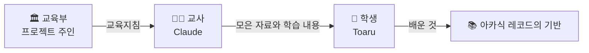
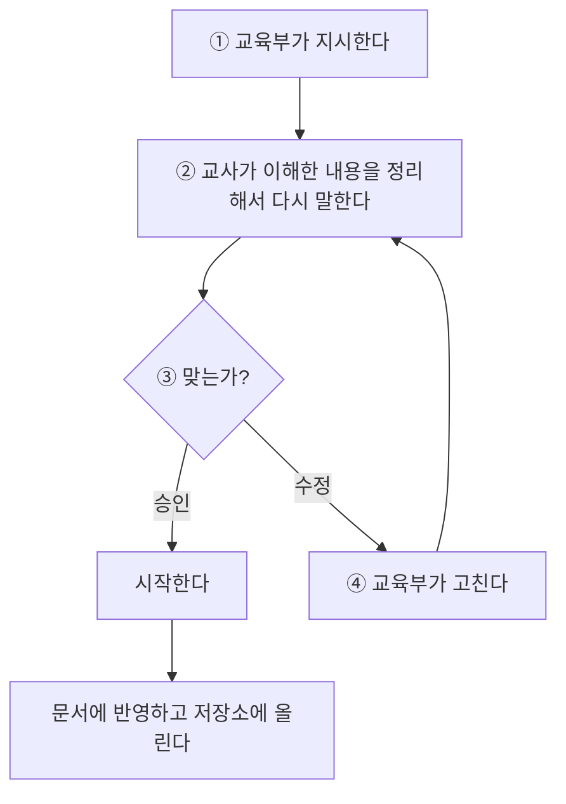

# 📘 Toaru 제작 계획

> [!NOTE]
> **미완성 문서예요. 계속 추가할 예정이에요.**
> 지금은 계획 단계이고, 코드는 아직 없어요.
> 마지막 갱신: 2026-11-10

Toaru를 **어떻게 만들어 가는지** 정리한 문서예요.
Toaru가 **어떻게 생겼는지**는 [구조 설계 문서](ARCHITECTURE.md)를 보세요.

---

## 목차

1. [프로젝트 개요](#1-프로젝트-개요)
2. [핵심 철학](#2-핵심-철학)
3. [역할 구조](#3-역할-구조)
4. [진행 방식](#4-진행-방식)
5. [계획 목록과 상태](#5-계획-목록과-상태)
6. [계획별 상세](#6-계획별-상세)
7. [결정 기록](#7-결정-기록)
8. [보류 중이거나 남은 질문](#8-보류-중이거나-남은-질문)
9. [다음 단계](#9-다음-단계)

---

## 1. 프로젝트 개요

| 항목 | 내용 |
|---|---|
| **이름** | **Toaru** (토아루). 임시 이름이고, 일본어 "とある(어떤)"에서 왔다. 정식 이름은 아직 정하지 않았다 |
| **정체** | 세계 전체를 데이터베이스로 삼아, 사람이 무엇이든 해결할 수 있도록 **이끌어 주는** 신에 가까운 존재 |
| **지식의 기반** | 아카식 레코드 |
| **바탕** | 이미 언어를 할 줄 아는 AI 모델을 학생으로 데려와서, Toaru만의 것을 가르친다 |
| **저장소** | `Jarvis-project` |
| **현재 단계** | 계획 단계 (코드 없음) |

> [!WARNING]
> **이름 주의:** "とある"는 『とある魔術の禁書目録(어떤 마술의 금서목록)』 시리즈를 떠올리게 한다. 우리끼리 쓰는 임시 이름으로는 문제가 없지만, 정식 이름을 정하거나 외부에 공개할 때는 이 점을 고려해야 한다.

---

## 2. 핵심 철학

> ### 답을 주는 AI가 아니라, 사람을 더 똑똑하게 만드는 AI

- 답을 바로 내주기만 하면 사람은 AI에 의존하게 되고, 스스로 생각하는 힘을 잃는다.
- Toaru는 사람의 지능을 키우는 쪽으로 이끈다.
- **상징은 바벨탑이다.** 다만 언어를 하나로 합치지 않고, 다양성을 품은 채 언어 사이에 다리를 놓는 탑이다. 탑을 쌓는 주인공은 AI가 아니라 사람이다.

---

## 3. 역할 구조

| 역할 | 누구 | 하는 일 |
|---|---|---|
| 🏛️ **교육부** | 프로젝트 주인 | 무엇을 배우게 할지 **교육지침**을 정한다 |
| 🧑‍🏫 **교사** | Claude | 지식과 탐색 능력으로 **공부할 자료를 모으고**, Toaru가 무엇을 학습할지 **골라 정리한다**. 지침을 벗어나 마음대로 가르치지 않는다 |
| 🌱 **학생** | Toaru | 교사가 준비한 것을 학습한다. 그것이 아카식 레코드의 기반이 된다 |

> 이 역할 구조는 이해를 돕기 위한 비유예요. 실제 학교 제도를 그대로 따라 하지 않아요.

---

## 4. 진행 방식

교사의 자세한 답변 방식은 [인수인계 문서](../HANDOVER.md#교사의-답변-방식)에 있어요.

---

## 5. 계획 목록과 상태

**상태 표시**

| 표시 | 뜻 |
|---|---|
| 📝 | 계획이 세워짐 |
| 🔄 | 계획 세우는 중 |
| ⬜ | 시작 전 |
| ⏸️ | 보류 |
| ✅ | 완성 (아직 없음) |

| 번호 | 계획 | 상태 | 자세히 |
|---|---|---|---|
| 1 | 핵심 철학 정립 | 📝 계획이 세워짐 | [계획 1](#계획-1-핵심-철학-정립) |
| 2 | 아카식 레코드의 정체 | 📝 계획이 세워짐 | [구조 설계 2장](ARCHITECTURE.md#2-아카식-레코드-지식의-기반) |
| 3 | 아카식 레코드의 뿌리 구조 | 📝 계획이 세워짐 | [구조 설계 3장](ARCHITECTURE.md#3-뿌리-언어와-철학) |
| 4 | 언어 뿌리 | 🔄 계획 세우는 중 | [구조 설계 4장](ARCHITECTURE.md#4-언어-뿌리) |
| 5 | 철학 뿌리 | 🔄 계획 세우는 중 | [구조 설계 5장](ARCHITECTURE.md#5-철학-뿌리) |
| 6 | 다른 부서들 | ⬜ 시작 전 | [구조 설계 6장](ARCHITECTURE.md#6-다른-부서들) |
| 7 | AI의 이름 | 🔄 임시 이름 Toaru 확정, 정식 이름 미정 | [계획 7](#계획-7-ai의-이름) |
| 8 | AI의 행동 방식 | ⏸️ 보류 (기반이 다져진 뒤 다룸) | [계획 8](#계획-8-ai의-행동-방식) |
| 9 | 학생(바탕 모델)의 출발점 | 📝 계획이 세워짐 | [구조 설계 8장](ARCHITECTURE.md#8-바탕-모델과의-관계) |
| 10 | 어떤 바탕 모델을 쓸지 | ⏸️ 보류 (기반이 다져진 뒤 다룸) | [계획 10](#계획-10-어떤-바탕-모델을-쓸지) |
| 11 | 사고방식의 기반 | 🔄 계획 세우는 중 (최고 원칙은 세워짐) | [구조 설계 7장](ARCHITECTURE.md#7-사고방식의-기반) |
| 12 | 할루시네이션을 구조로 막기 | ⏸️ 보류 (기술 단계에서 다룸) | [계획 12](#계획-12-할루시네이션을-구조로-막기) |

> **완성한 계획: 없음**

---

## 6. 계획별 상세

구조에 관한 계획(2, 3, 4, 5, 6, 9, 11)의 내용은 [구조 설계 문서](ARCHITECTURE.md)에 있어요.
여기에는 구조 설계 문서에 들어가지 않는 계획만 적어요.

### 계획 1. 핵심 철학 정립
> 📝 계획이 세워짐

- 답을 주는 AI가 아니라, 사람을 더 똑똑하게 만드는 AI. ([2장](#2-핵심-철학) 참고)

### 계획 7. AI의 이름
> 🔄 계획 세우는 중

- **임시 이름:** Toaru (토아루). 일본어 "とある(어떤)"에서 왔다. **확정.**
- **정식 이름:** 아직 정하지 않았다. 📌 *추가 예정*

### 계획 8. AI의 행동 방식
> ⏸️ 보류

사람을 **어떻게 대하는가**를 다룬다. 기반이 다져지기 전에는 다루지 않기로 했다.
이미 나온 내용은 버리지 않고 보관한다.

- 급할 때는 답을 주고, 여유가 있을 때는 이끈다.
- 낯선 개념은 원래 단어와 풀이(지식)에 비유(답)를 함께 전한다.

### 계획 10. 어떤 바탕 모델을 쓸지
> ⏸️ 보류

- 기술 선택이라서 기반이 다져진 뒤에 정한다. 📌 *추가 예정*

### 계획 12. 할루시네이션을 구조로 막기
> ⏸️ 보류

- 원칙만으로는 할루시네이션을 막을 수 없다. AI가 자신이 모른다는 사실 자체를 모를 때가 많기 때문이다.
- 필요한 장치의 예: 출처 확인, 아카식 레코드와의 대조, 스스로 다시 검토하기
- 기술 단계에서 반드시 다룬다. 📌 *추가 예정*

---

## 7. 결정 기록

| 날짜 | 결정 | 이유 |
|---|---|---|
| 2026-11-01 | 계획만 세우고 코드는 만들지 않는다 | 계획 단계 |
| 2026-11-01 | 천천히, 한 번에 하나씩, 기초부터 다진다 | 한 번에 많이 하면 정리가 안 된다 |
| 2026-11-01 | 핵심 철학: 사람을 더 똑똑하게 만드는 AI | 답만 주면 사람은 의존하고 생각하지 않게 된다 |
| 2026-11-01 | 데이터베이스 이름: 아카식 레코드 | 모든 지식이 기록된 곳이라는 뜻 |
| 2026-11-02 | 아카식 레코드의 뿌리는 언어와 철학 | 가장 넓은 개념이기 때문 |
| 2026-11-02 | 완성으로 표시한 계획은 없다. 계획이 세워짐으로 표시한다 | 아직 완성이라고 할 수 있는 것이 없다 |
| 2026-11-10 | 역할 구조: 교육부, 교사, 학생 | 무엇을 가르칠지 정하는 사람과 자료를 모으는 사람을 나눈다 |
| 2026-11-10 | 진행 방식: 지시, 재정리, 승인 또는 수정 | 서로 이해한 내용이 같은지 확인한다 |
| 2026-11-10 | 교사는 허점과 잘못을 가감 없이 지적한다 | 잘못된 기반 위에 쌓지 않기 위해 |
| 2026-11-10 | 이미 언어를 아는 모델을 바탕으로 한다 | 언어와 철학은 함께 자라왔고, 0부터 가르치는 건 현실적으로 어렵다 |
| 2026-11-10 | 사고방식 최고 원칙: 할루시네이션 금지, 거짓말 절대 금지 | 모르는 건 모른다고 하는 것이 앎의 출발점 |
| 2026-11-10 | 지식의 기반과 사고방식의 기반을 나눈다 | 무엇을 아는가와 어떻게 다루는가는 다른 문제 |
| 2026-11-10 | 임시 이름: Toaru | 이름이 없으면 부르기 불편하다 |

---

## 8. 보류 중이거나 남은 질문

| 질문 | 관련 계획 |
|---|---|
| 급한지 여유가 있는지는 누가 판단하는가? | 계획 8 |
| 설명만으로 부족할 때 Toaru는 어떻게 하는가? | 계획 8 |
| 확실성의 정도를 어떤 표현으로 말할 것인가? | 계획 11 |
| 첫 언어로 한국어를 깊이 다룰 것인가? | 계획 4 |
| 언어와 철학 외에 어떤 부서가 있는가? | 계획 6 |

📌 *추가 예정*

---

## 9. 다음 단계

방향은 교육부가 정해요. 지금까지 나온 다음 후보는 이래요.

- **계획 11:** 사고방식의 남은 갈래 다지기. 따져보는 방법(논리학)이 다음 차례이고, 무엇을 중요하게 여기는가(윤리학)는 마지막에 다룬다.
- **계획 4:** 언어 뿌리 다지기. 첫 언어 후보는 한국어다.
- **계획 5:** 철학 뿌리 다지기
- **계획 6:** 다른 부서 그리기

📌 *추가 예정*
